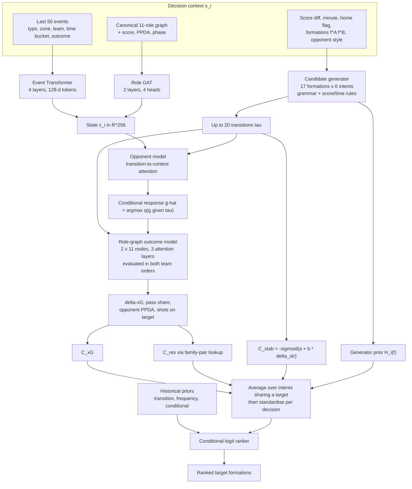
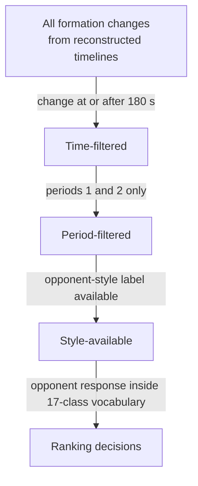
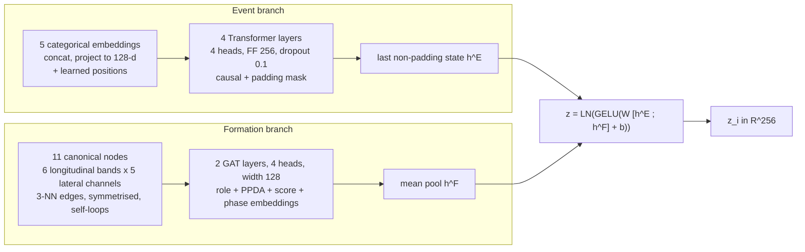
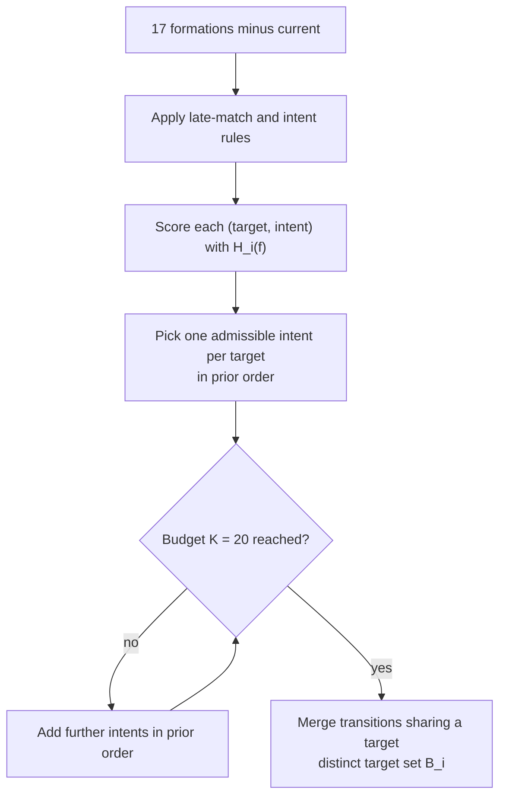
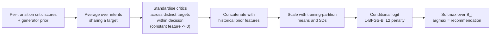
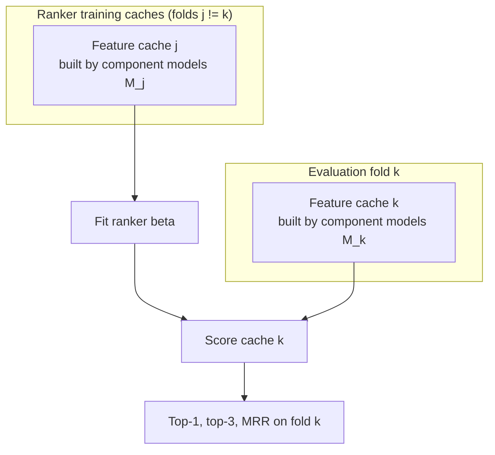

# RAMFP — Response-Aware Multi-Critic Formation Planning

Ranking candidate football formation changes from event data by combining opponent-response prediction, formation-pair outcome modelling and tactical critics with historical priors.

> **Status:** results are being updated and are not included here.

---

## Contents

1. [Overview](#1-overview)
2. [Problem formulation](#2-problem-formulation)
3. [Architecture](#3-architecture)
4. [Data](#4-data)
5. [Components](#5-components)
6. [Evaluation design](#6-evaluation-design)
7. [Training configuration](#7-training-configuration)
8. [Scope and known limitations](#8-scope-and-known-limitations)
9. [Roadmap](#9-roadmap)
10. [Data licence](#10-data-licence)
11. [Glossary](#11-glossary)
12. [Background](#12-background)

---

## 1. Overview

When a coach changes formation, which formation do they pick, and what would the opponent do about it? RAMFP ranks replacement formations at recorded change points using:

| Component | Role |
|---|---|
| **State encoder** | Encodes recent events and canonical formation roles into a state vector |
| **Candidate generator** | Tactical grammar over formations × intents; supplies a prior |
| **Opponent model** | Predicts the opponent's formation response to each candidate |
| **Outcome model** | Role-graph model predicting window outcomes for a formation pair |
| **Tactical critics** | xG advantage, structural stability, counter-resistance |
| **Ranker** | Conditional logit over critic features and historical priors |

Core question: do learned opponent and outcome models add information **beyond historical transition patterns**? Evaluation is offline, as agreement with recorded coach choices. Agreement with historical decisions is treated as distinct from evidence that a recommendation improves match outcomes.

---

## 2. Problem formulation

Let `A` be the team changing formation and `B` its opponent. At decision `i` the context `s_i` contains:

- recent event sequence `E_i` (50 events strictly before the change)
- current formations `f_i^A`, `f_i^B`
- score difference `d_i`, minute `m_i`, home status
- pre-change opponent pressing intensity (PPDA over `[t−300, t)`)
- phase proxy (attack / defence / transition)
- opponent style (cluster label)

A **candidate** is `τ = (f_i^A, f, ι)`: replacement formation `f` with tactical intent `ι`. Transitions sharing a target formation are merged. With distinct targets `B_i`:

$$\widehat f_i=\arg\max_{f\in\mathcal B_i}S_\beta(s_i,f)$$

**Label:** the coach's recorded replacement formation. Targets absent from the candidate set receive zero credit.

**Out of scope:** whether or when to change formation, keeping the current formation, and outcomes under unchosen alternatives.

---

## 3. Architecture

### 3.1 End-to-end flow



### 3.2 Stages

| Stage | What happens |
|---|---|
| **State and candidates** | 50 pre-change events → Event Transformer; 11 canonical roles + score/PPDA/phase → Role GAT; fused into a 256-d state `z_i`. The grammar produces ≤ 20 transitions plus a generator prior `H_i(f)`. |
| **Opponent-conditioned assessment** | The opponent model attends from the transition to the encoded state and style. The argmax predicted response and the candidate form a pair of 11-node role graphs fed to the outcome model. |
| **Multi-critic ranking** | Three critics are averaged over intents sharing a target, standardised, combined with historical priors and ranked by a conditional-logit model. |

### 3.3 Inference for one decision

```mermaid
sequenceDiagram
  participant C as Context s_i
  participant G as Generator
  participant O as Opponent model
  participant W as Outcome adapter
  participant K as Critics
  participant R as Ranker
  C->>G: formations, score, minute
  G-->>C: up to 20 transitions and H_i(f)
  loop each transition tau
    C->>O: z_i, style, tau
    O-->>C: g-hat(tau) = argmax q(g | tau)
    C->>W: (f^A -> f) vs g-hat, context
    W-->>K: F(A,B) and F(B,A)
    K-->>C: C_xG, C_res (C_stab from structural distance)
  end
  C->>R: per-target averaged, standardised critics + priors
  R-->>C: softmax over distinct targets; argmax is the recommendation
```

---

## 4. Data

### 4.1 Source and decision construction

- Source: StatsBomb Open Data event data across multiple competition–season pairs.
- Formation histories are reconstructed from **Starting XI** and **Tactical Shift** events.
- A shift counts as a change only if its code differs from the team's preceding formation.
- Half-time changes are retained and flagged.



### 4.2 Opponent-response label

- Window `[t, t+900)` seconds.
- Label = formation at the **first opponent Tactical Shift** in the window; if none, the timeline formation at the horizon.
- Response-change indicator = label differs from the opponent's formation at decision time.
- Decisions with incomplete follow-up windows are retained and flagged.

### 4.3 Model inputs

| Input | Detail |
|---|---|
| Event sequence | Last 50 events strictly before the change (minimum extraction requirement 10) |
| Event fields (5, categorical) | type · pitch zone (6×4 grid) · acting team relative to changer · 15-minute time bucket · outcome; dedicated codes for unknown types and missing locations |
| Coordinates | Recorded 120×80 pitch; no reflection during extraction |
| Period offsets (s) | 0 / 2,700 / 5,400 / 6,300 for periods 1–4; shootout events excluded |
| Phase proxy | Changer's share of passes, carries, dribbles, shots, ball receipts among the last 10 events: ≥ 0.65 attack, ≤ 0.35 defence, else transition |
| Structured | score, minute, opponent formation, pre-change opponent PPDA, phase proxy |
| Formation graph | Canonical 11-role templates (no tracking data) |

Observed intent (analysis only) is a proxy from changes in canonical forwardness, width and defensive-line height.

### 4.4 PPDA and style

$$\mathrm{PPDA}_B(w)=\frac{P_A(w;x<80)}{D_B(w;x>40)}$$

Thresholds use the acting team's coordinate frame. The denominator counts tackles, interceptions, fouls committed, blocks and clearances (pressure events excluded). A zero denominator gives an undefined ratio.

**Opponent style** is a cluster label over team behaviour summaries: PPDA mean/SD/slope, pass length, possession-count share, lateral event spread, passes per possession, median longitudinal defensive-action location. Teams above a minimum match count define the clusters; others are assigned to the nearest centroid. The cluster count is selected over a sweep of `k`.

### 4.5 Outcome windows

| Property | Value |
|---|---|
| Start / stride / nominal length | 180 s / 60 s / 600 s |
| Retention rule | Known initial formations; ≥ 5 events spanning ≥ 300 s; no Starting XI or Tactical Shift for either team inside the window |
| Meaning of "stable" | Stability of recorded tactical annotations, not of player positions |
| Targets | home−away shot xG · home pass share (0.5 if no passes) · away-team PPDA · shots tagged Saved or Goal (both teams) |
| Missing targets | Undefined PPDA targets are imputed with the training mean in training and excluded in evaluation |
| Split | Largest numerical season ID per multi-season competition held out |

Pass share is a proxy for possession, not possession time.

---

## 5. Components

### 5.1 State encoder



The event branch is pretrained on next-event-type prediction (50-event windows, stride 50, both team perspectives; validation = last 5% of rows), then fine-tuned with the opponent model.

### 5.2 Candidate generator and prior

$$H_i(f)=-0.02\,D(f_i^A,f)+0.15\,(-d_i)\,\Delta a_i(f)$$

- `D`: Frobenius distance between column-sorted canonical coordinates `P(f) ∈ R^{11×2}`; sorting columns separately compares geometry without assigning players to new roles.
- `Δa_i(f)`: change in forward count. `−d_i > 0` when trailing, so the prior rewards adding forwards when behind.
- *Illustration (hypothetical numbers):* trailing by one, 4-4-2 → 4-3-3 (+1 forward) with `D = 2.0` gives `−0.04 + 0.15 = +0.11`.

| Grammar rule | Effect |
|---|---|
| Vocabulary | 17 formations (current excluded) × 6 intents: offensive, defensive, wide, narrow, pressing, conservative |
| From minute 75, leading by ≥ 2 | Cannot add forwards |
| From minute 75, trailing by ≥ 2 | Cannot add defenders |
| Offensive intent | Cannot reduce forwards |
| Conservative intent | Cannot reduce defenders |
| Other intents | No directional restriction |
| Personnel check | Optional; inactive without player-role lists |



Two-stage selection stops a few formations from consuming the whole budget with different intents.

### 5.3 Opponent model

- Query = source-formation + target-formation + intent embeddings.
- Cross-attention over projected state and style tokens → residual + LayerNorm + feed-forward.
- Heads:
  - `p_i`: sigmoid probability that the opponent **changes** formation.
  - `q_i(g | τ)`: 17-class distribution over the new formation, trained on changed-response examples only.

$$\pi_i(g\mid\tau)=(1-p_i)\,\mathbf 1[g=f_i^B]+p_i\,q_i(g\mid\tau)$$

$$\mathcal L_{\rm opp}=\mathcal L_{{\rm CE},R=1}+0.1\,\mathcal L_{{\rm KL},R=1}+\mathcal L_{\rm BCE}$$

KL is to the uniform distribution; BCE uses all decisions with batch-level positive weighting when both classes are present.

**Design note:** overall opponent evaluation uses the mixture `π`; candidate scoring uses only `ĝ = argmax_g q(g | τ)`, a single conditional response that ignores `p_i`.

### 5.4 Outcome model and planning adapter

- Two 11-node team graphs; templates define roles and within-team edges (fallbacks cover the 22-code vocabulary).
- Role-pair edge features summarise historical window-xG outcomes when mapped roles co-occur (aggregate associations, not observed duels).
- 3 attention layers (4 heads, width 128), separate team mean pooling, 4-target readout, loss weights `(3, 1, 0.1, 1)` for (xG, pass share, PPDA, shots on target).
- Bidirectional inter-team edges and team-swap augmentation.
- **No-graph reference:** same node inputs and team pooling with message passing removed (mean-pooling MLP).

**Two-order adapter.** With `F_j(A,B)` the raw output for target `j` when our formation fills the first block (the reverse pass swaps formations and style labels and negates score difference):

$$\widehat{\Delta\mathrm{xG}}=\tfrac12\{F_{\rm xG}(A,B)-F_{\rm xG}(B,A)\},\quad
\widehat v=\tfrac12\{F_v(A,B)+1-F_v(B,A)\}$$

$$\widehat n=\tfrac12\{F_n(A,B)+F_n(B,A)\},\quad \widehat p=F_p(A,B)$$

| Output | Property under team swap |
|---|---|
| ΔxG | Antisymmetric |
| Pass share `v` | Complementary (sums to 1) |
| Total shots on target `n` | Symmetric |
| Opponent PPDA `p` | Directional (single order) |

These are algebraic consistency properties, not counterfactual validation. Current assumptions: own-team style defaults to cluster 0; venue is not used to restore home/away orientation; `z_i` is not an outcome-model input; the same PPDA is passed in both orders.

### 5.5 Critics

| Critic | Formula | Interpretation |
|---|---|---|
| xG advantage | `C_xG(τ) = ΔxG-hat(τ)` | Adapter's antisymmetrised xG difference |
| Structural stability | `C_stab(τ) = −σ(a + b·δ_str(f_i^A, f))` | Negative predicted concession probability from a fitted logistic of structural distance (`δ_str` is distinct from generator distance `D`) |
| Counter-resistance | `C_res(τ) = L(b_F(f), b_F(ĝ))` | Mean predicted xG advantage for a formation-family pair; lookup built from at most 400 permitted windows per cell, sparse cells flagged, global fallback for unsupported pairs |

- Counter-resistance is an average matchup score, not a worst-case guarantee.
- The stability score is not a validated or calibrated safety measure.
- If the fitted logistic cannot load, the runner falls back to a deterministic distance score.
- A separate stability MLP exists for auxiliary comparison and is not used by the scorer.

### 5.6 Ranker



$$P_\beta(f\mid i)=\frac{\exp(\boldsymbol\beta^\top\mathbf x_{if})}{\sum_{u\in\mathcal B_i}\exp(\boldsymbol\beta^\top\mathbf x_{iu})},\qquad
\min_\beta\;-\!\!\sum_{i\ \text{covered}}\log P_\beta(f_i^{\rm obs}\mid i)+\|\beta\|_2^2$$

**Historical features**

- `T(f | s)`: training source→target transition frequency, additive smoothing 0.5. `G(f)`: smoothed target frequency.
- Conditional transition for conditioning value `c`:

$$T_c(f\mid s,c)=\frac{N(s,c,f)+\lambda_c\,T(f\mid s)}{N(s,c)+\lambda_c}$$

- `λ = 5` for opponent-style and opponent-backline conditions; `λ = 10` for team-conditioned. Team target frequencies are smoothed toward `G(f)` with strength 5. Backlines are grouped into 3, 4, 5 defenders.
- Counts and feature scaling use the ranker-training partition only.

**Variants**

| Variant | Features |
|---|---|
| Random | Independent random score per distinct candidate |
| Equal critics | Mean of the three standardised critic columns |
| Learned critics + H | 3 critics + `H` |
| Transition matrix | Changing team's historical source→target counts |
| Basic priors | `log T`, `log G`, `H` |
| Conditional priors | Style-, backline-, team-conditioned log transitions, log team frequency, `log G`, `H` |
| Expanded priors + critics | All basic + conditional priors + 3 critics (10 scalar features) |
| + state `z_i` | Expanded model plus all 256 coordinates of `z_i` broadcast to every candidate |

**Shared state features cancel.** For a candidate-constant vector `z_i` with weights `β_z`, the score is `β_xᵀx_if + β_zᵀz_i`; the second term is the same constant `c_i` for every candidate and

$$\frac{e^{a_f+c_i}}{\sum_u e^{a_u+c_i}}=\frac{e^{a_f}}{\sum_u e^{a_u}}$$

so a linear ranker's ordering cannot change. Testing event context needs candidate-dependent interactions or a nonlinear ranker.

**Ablation design.** Isolating the critics requires identical prior sets with and without critics. "Learned critics + H" vs "Equal critics" likewise changes both weight learning and the inclusion of `H`.

---

## 6. Evaluation design

### 6.1 Splits

- Five folds grouped by match.
- For evaluation fold `k`, component models (opponent, outcome, counter-resistance lookup, stability critic) are requested with fold `k` excluded; candidate features are cached per fold and each ranker is fitted on the other four caches.



A fully nested protocol would build every inner training feature using only the current outer training partition.

### 6.2 Metrics

For observed target `f_obs`:

$$r_i=\begin{cases}1+\sum_{f\in\mathcal B_i}\mathbf 1[S_i(f)>S_i(f_{\rm obs})] & f_{\rm obs}\in\mathcal B_i\\ \infty & \text{otherwise}\end{cases}$$

- Top-k = mean of `1[r_i ≤ k]`; MRR = mean of `1/r_i` with `1/∞ = 0`.
- Ties receive the best rank; uncovered targets stay in the denominator with zero credit; all methods share the same candidate groups.
- **Opponent:** top-1, top-3, NLL, ECE (ten equal-width bins); change detection via AUROC and average precision; changed-only formation accuracy.
- **Outcome model:** Pearson correlation per target on a non-overlapping validation subset; neural MSE in standardised units (`MSE_orig = σ_j² · MSE_std`).
- **Stability:** AUROC and average precision.

### 6.3 Baselines

| Task | Baselines |
|---|---|
| Ranking | Random; equal critics; transition matrix; basic priors; conditional priors |
| Opponent | Random Dirichlet probabilities; training response frequencies; persistence (opponent keeps its formation); current→response transition matrix; logistic regression and gradient boosting on style, score, minute, venue, pre-change PPDA, phase |
| Outcome | Ridge and histogram gradient boosting on formation indicators + structured context; mean-pooling MLP |
| Stability | Raw structural distance; logistic on structural distance; stability MLP |

### 6.4 Uncertainty

- **Ranking:** 5,000 paired match-level bootstrap replicates (seed 0), keeping all decisions of each sampled match; percentile 2.5 / 97.5 bounds. Models are not refitted, so intervals are conditional on the fitted models.
- **Opponent:** sample SD over fold–seed rows (seeds 0, 1, 2 × five folds).
- **Outcome model:** sample SD across seeds 42, 43, 44.

### 6.5 Auxiliary procedures

**Calibration.** Held-out matches are split into two groups; a temperature for formation logits and an affine transform of the response-change logit are fitted by minimising mixture NLL on one group.

**Conformal sets.** Scores `a_i = 1 − P_i(g_i)`; level `ℓ_α = min{1, ⌈(n_c+1)(1−α)⌉ / n_c}`; set `Γ(P) = {g : 1 − P(g) ≤ q̂_α}`.

**Heuristic revision (optional).** Revises up to three leading transitions for at most two rounds. Predicted pass share and PPDA from the first active candidate are normalised and alternated through a perturbation vector; 0.1 × this vector is added to the state embedding, which is rescaled to its original norm. The full candidate list is then rescored on a common scale. Revision stops on an empty prediction set or a set larger than a threshold (default one).

**Planner diagnostic.** Weighted critic combination `(0.5, 0, 0.5)` for xG / stability / counter-resistance; a target is ranked by its best transition score.

**Before/after measurement.** Ratio-based difference-in-differences on PPDA with same-match control windows:

$$\Delta_i^{\rm DiD}=(Y_{i,T,\rm post}-Y_{i,T,\rm pre})-(Y_{i,C,\rm post}-Y_{i,C,\rm pre})$$

---

## 7. Training configuration

| Component | LR | Batch | Max epochs | Patience | Optimiser |
|---|---:|---:|---:|---:|---|
| Event pretraining | 3e-4 | 128 | 5 | — | AdamW |
| Opponent | 3e-4 | 64 | 40 | 8 | AdamW |
| World model / MLP | 3e-4 | 32 | 100 | 10 | AdamW |
| Stability MLP | 1e-3 | Full | 400 | — | AdamW |

- **Opponent:** weight decay 0.01, dropout 0.1, warm-up fraction 0.1, gradient clip norm 1, left–right reflection augmentation, encoder fine-tuned; seeds 0, 1, 2.
- **World model:** seeds 42, 43, 44; checkpoint selection by summed standardised validation MSE; target means/SDs from the training partition.
- **Stability:** weight decay 1e-4, class-balanced BCE, three seeds; logistic reference fitted once per fold.

---

## 8. Scope and known limitations

- Event data omit continuous off-ball movement; canonical roles are templates, not tracked positions.
- Opponent-response labels use a first-shift rule over a fixed horizon; incomplete windows describe only the available record.
- Outcome windows overlap and are dependent within a match; the season-based split is not chronological.
- Style clusters summarise measured features, not fixed team qualities.
- Personnel feasibility is only partly represented.
- Task covers replacement formation at observed changes only; no change timing, no "stay", no counterfactual outcomes.
- Aggregate agreement does not imply equal performance across competitions, genders, playing levels or teams with limited history.
- Outputs support contextual assessment; they are not evidence of player ability or coaching competence.

---

## 9. Roadmap


Also planned: matching no-style opponent runs, feature-cache hashing with per-decision logging, and style-file provenance tracking.

---

## 10. Data licence

Event data come from StatsBomb Open Data and are used under StatsBomb's licence and attribution terms. Data are not included in this repository. Match identifiers permit linkage to public records, so processed data are not anonymous.

---

## 11. Glossary

| Term | Meaning |
|---|---|
| **Formation change** | A Tactical Shift whose code differs from the team's previous formation |
| **Decision** | One recorded change that passes the filters in §4.1 |
| **Candidate / transition** | `(current formation, replacement formation, intent)` |
| **Intent** | One of six tactical labels constraining the grammar |
| **Critic** | A learned or lookup signal scoring a candidate |
| **Prior** | Historical-frequency feature (transition probability, target frequency, conditional variants) |
| **Conditional logit** | Softmax over a variable-size candidate set with a linear score |
| **PPDA** | Passes per defensive action; lower = more pressing |
| **xG** | Expected goals |
| **ECE / NLL / MRR** | Expected calibration error / negative log-likelihood / mean reciprocal rank |
| **AUROC / AP** | Area under ROC / average precision |
| **Persistence** | Baseline predicting the opponent keeps its current formation |
| **Nested evaluation** | Every upstream model for a test fold trained without that fold |
| **Counter-resistance** | Average predicted xG advantage for a formation-family pair |

### Notation

| Symbol | Meaning |
|---|---|
| `A`, `B` | Changing team, opponent |
| `s_i`, `E_i` | Decision context, event sequence |
| `d_i`, `m_i` | Score difference, minute |
| `τ = (f_i^A, f, ι)` | Candidate transition |
| `𝓑_i` | Distinct target formations |
| `z_i ∈ R^256` | Fused state |
| `H_i(f)` | Generator prior |
| `D`, `δ_str` | Generator distance; structural distance for stability |
| `p_i`, `q_i(g|τ)`, `π_i` | Response-change prob.; conditional formation dist.; mixture |
| `ĝ_i(τ)` | Argmax predicted opponent response |
| `b_F`, `L` | Formation-family map; family-pair xG lookup |
| `β` | Ranker coefficients |

---

## 12. Background

Related lines of work this project builds on or contrasts with:

- **Action valuation and match context:** VAEP; deep action values from event sequences; possession value from tracking; SoccerMap; off-ball multi-agent action values.
- **Formation and defensive behaviour:** role-based formation analysis; SoccerCPD formation/role change detection; data-driven ghosting; studies of formation changes and performance; Markov-game models of tactical change.
- **Tactical recommendation:** TacticAI (corner-kick analysis with expert evaluation) and related generator–critic approaches.
- **Evaluation practice:** leakage in ML evaluation, cross-validation under dependence, probability calibration, conformal classification.
- **Architectures:** Transformer; graph attention networks.

These systems use different inputs, actions and evaluation targets, so reported performance is not directly comparable with agreement on recorded replacement formations.